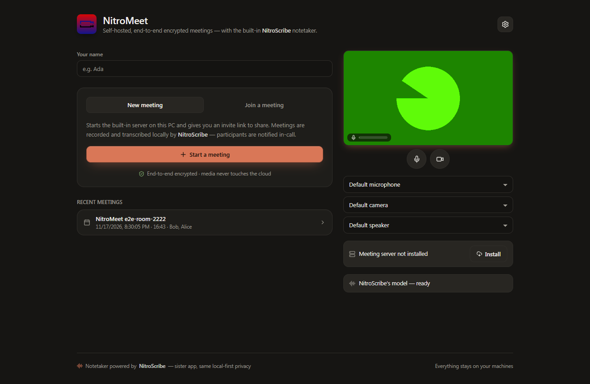
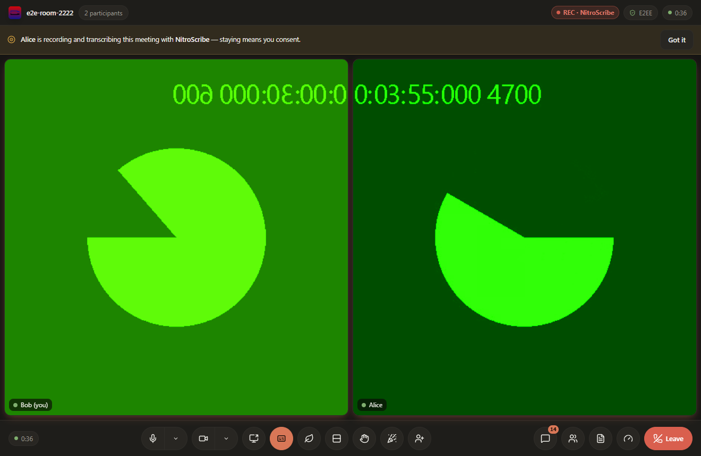

# NitroMeet

**Private, self-hosted video meetings — the meeting server runs inside the app.**

NitroMeet is a video-calling app with a built-in notetaker. When you start a meeting, a real SFU ([livekit-server](https://github.com/livekit/livekit)) launches on your own PC and the media flows directly between the people on the call. There is no cloud, no account, and nobody's servers in the middle — your PC is the server.

Other notetakers record one mixed audio stream and then guess who spoke. NitroMeet doesn't guess: the SFU hands it every participant's audio on its own track, already labeled with their identity, so every line of the transcript carries a real name.

| Lobby | In a meeting — recording consent shown to everyone |
| --- | --- |
|  |  |

## Features

- **End-to-end encrypted by default.** Rooms use insertable-streams E2EE: media is encrypted in the sender's browser sandbox and only decrypted on the receiving end. Even the host's own meeting server only ever relays ciphertext. The encryption key travels inside the invite link's fragment — it is never sent over the network, so even the invite endpoint can't leak it.
- **Host on your LAN.** Start a meeting and hand out the invite string. Guests on the network join from their own NitroMeet app — the invite endpoint on the host's machine signs them in. No sign-ups, no lobby, no links through a third party.
- **Decode only what you see.** VP9 SVC with simulcast, adaptive stream and dynacast: the SFU forwards just the layers each client is actually displaying, so a grid of 12 costs far less bandwidth and CPU than it looks.
- **Low-power mode** for big calls: shrinks or pauses off-screen video so a laptop survives a long meeting.
- **Live captions and accurate transcripts.** whisper.cpp runs locally and transcribes each participant separately. Attribution isn't approximate — every line comes from an identified track. If NitroScribe is already installed, its engine and speech models are reused — no second download — or you can point NitroMeet at any `.bin` you have, or switch to an OpenAI-compatible transcription API in Settings.
- **Recording consent, built in.** Hosts and joiners both acknowledge the recording notice before entering. Anyone recording broadcasts it in-call: a persistent red **REC · NitroScribe** indicator plus a banner telling everyone who is recording — staying in the call is consent.
- **Meeting notes from your own AI.** Turns the transcript into clean notes through a local [Ollama](https://ollama.com) model by default, or any OpenAI-compatible endpoint you point it at.
- **Sends meetings to [NitroScribe](https://github.com/eduard-georgescu/nitroscribe), its sister app.** Finished meetings are written straight into NitroScribe's native meetings folder (or exported as a file it can import), where you get AI notes, search and cross-meeting chat. Export to Markdown, TXT, SRT or JSON either way.

## How it works

- **The SFU is a child process.** NitroMeet downloads the official `livekit-server` binary once (SHA-256 verified, release pinned in `src/shared/manifests.ts`) and runs it from your data folder only while you're in a meeting.
- **Tokens are minted locally.** The app generates its own API keypair on first run and signs LiveKit join tokens itself. There is no LiveKit account anywhere in the loop.
- **Guests get in through the invite endpoint.** While hosting on the LAN, a tiny HTTP server on port 7889 answers `GET /invite?room=…&name=…` with a short-lived (2 h) signed token — but only for rooms the host actually created (LiveKit `auto_create` is off and `/invite` is rate-limited, so the room code is the capability). The invite link the host shares carries the E2EE key in its `#fragment`, which browsers never send to any server: the endpoint only ever mints tokens, it never sees the key. Guests who join with just the room code get no key and can still sit in the room — encrypted, but without decryption they only see encrypted media.
- **The notetaker listens per track.** The renderer taps each participant's audio with an AudioWorklet and streams PCM to the main process, which VAD-gates it, cuts it into whisper windows and asks a local `whisper-server` for text. Because each channel is opened for a specific participant, every transcript line is labeled with their name — no diarization, no speaker clustering.
- **NitroScribe reads the output natively.** Meetings are saved as plain JSON, and `sendToNitroScribe` writes the same file format NitroScribe produces itself (`source.format: 'NitroMeet'`), so transcripts land there with speakers already named.
- **Recording is announced, not secret.** Every participant consents on the way in. When recording/transcription is on, the recorder publishes an `nm.rec` notice over the E2EE data channel — late joiners get it re-sent — and everyone sees who is recording and a persistent REC indicator for as long as it runs.

## Ports

| Port | Used for |
| --- | --- |
| 7880 | LiveKit signaling — WebSocket + HTTP API |
| 7881 | WebRTC over TCP (fallback) |
| 7882 | WebRTC over UDP (muxed) |
| 7889 | LAN invite endpoint for guests |

The first time you host on the LAN, Windows Firewall will ask to allow these — approve it or guests can't reach you.

## Joining a meeting

1. Install NitroMeet on your PC.
2. Click **Join meeting**.
3. Paste the invite string the host sent you (it contains their address and the room code) — or type the host's address and code in by hand — pick your display name, and join.

That's it. Your mic, camera and screen share work the same way they do anywhere else, and the call is end-to-end encrypted with the key carried inside the invite link — if you joined with only a room code, paste the encryption key the host reads out to decrypt everyone's media.

## Meetings over the internet

NitroMeet is LAN-first today. Two ways to go further:

- **Port-forward the host.** Forward ports 7880–7882 (and 7889 if you want remote invites) to the host machine and share your public address. This works now; a cleaner TURN-based path is on the roadmap.
- **Use an external LiveKit endpoint.** Settings → Server accepts any LiveKit-compatible URL + API key/secret (for example a LiveKit Cloud project or your own server). Hosting then happens on that endpoint — the app creates rooms and mints tokens with your credentials — while the local invite endpoint still hands tokens to guests on your LAN.

## Privacy

- **Your media never touches a cloud.** Hosts run the server; media flows peer-to-SFU-to-peer between participants' machines and is E2EE-encrypted the whole way.
- **Even the host can't read the media.** The SFU relays ciphertext, and the E2EE key never touches the network — it lives in the invite link's URL fragment, which browsers and HTTP clients never transmit.
- **Honest caveat:** the LAN invite endpoint is plain HTTP on port 7889, so a join *token* crosses your LAN in cleartext. Anyone who can sniff your local network could join the room — but E2EE means they still can't read the media without the key, which never crosses the wire.
- **Stored secrets are encrypted.** API keys live in `secrets.json` under Windows DPAPI (Electron `safeStorage`), bound to the endpoint hostname they were saved for — `settings.json` never contains a key.
- **The window can't phone home.** The renderer's content security policy only allows WebSocket and localhost connections — exactly what it needs to talk to a LiveKit server — and nothing else.
- **Transcripts and recordings are local files.** Meetings live as plain JSON in `%APPDATA%\NitroMeet`; nothing syncs anywhere unless you send it (to your own NitroScribe folder, or an endpoint you chose).
- **Verified downloads.** The meeting server, speech engine and models download once and are checked against pinned SHA-256 fingerprints.
- **No telemetry:** no accounts, analytics, crash reporting or auto-updates.

> Please make sure the people you meet with are OK with being transcribed. Recording laws differ by country and state.

## Install

1. Download `NitroMeet-Setup-x.y.z.exe` from [Releases](../../releases).
2. Run it. The installer isn't code-signed, so Windows SmartScreen may ask you to confirm ("More info" → "Run anyway").
3. On first launch the app downloads the meeting server (about 30 MB). For transcripts it needs a speech model — if NitroScribe is installed, NitroMeet reuses its engine and models automatically (no download); otherwise pick one in Settings → Transcription, browse for a `.bin` you already have, or switch the engine to a transcription API.
4. For AI notes, install [Ollama](https://ollama.com) and pull a model (`ollama pull llama3.2:3b`), or point Settings → AI model at your own endpoint.

**Requirements:** Windows 10/11 (64-bit), a mic and camera, about 2 GB of disk space (plus the speech model if you want transcripts). An NVIDIA GPU speeds up transcription but isn't required.

## Build from source

```bash
git clone <this repo>
cd nitromeet
npm ci
npm run dev      # run with hot reload
npm test         # unit tests
npm run dist     # build the installer into dist/
```

See [AGENTS.md](AGENTS.md) for architecture notes.

## NitroMeet vs Zoom — honestly

| | NitroMeet | Zoom |
| --- | --- | --- |
| Where your media goes | Your machines only; E2EE by default | Zoom's cloud; E2EE is an opt-in that disables features |
| Accounts | None, for anyone | Required to host |
| Hosting | Your PC is the server | Their data centers |
| Transcripts | Local, per-speaker accurate, free | Cloud add-on on paid tiers |
| Cost | Free, MIT-licensed | Free tier limits, paid plans |
| Mobile apps | — | iOS + Android |
| Phone dial-in | — | Yes |
| Big calls | Comfortable to ~20 people | Polished far beyond that, plus webinars |
| Maturity | New | A decade of edge cases already solved |

If you need dial-in, phones, or a 200-person all-hands, use Zoom. If you want a call that nobody else is inside of — and a notetaker that actually knows who said what — that's NitroMeet.

## Credits

NitroMeet stands on great open-source work:

| Component | Used for | License |
| --- | --- | --- |
| [LiveKit](https://github.com/livekit/livekit) (`livekit-server`, `livekit-client`, server SDK) | SFU, media stack, E2EE | Apache-2.0 |
| [whisper.cpp](https://github.com/ggml-org/whisper.cpp) + [OpenAI Whisper](https://github.com/openai/whisper) models | Speech engine | MIT |
| [Electron](https://www.electronjs.org), [React](https://react.dev), [Tailwind CSS](https://tailwindcss.com), [Lucide](https://lucide.dev) | App | MIT / ISC |

## License

[MIT](LICENSE)
